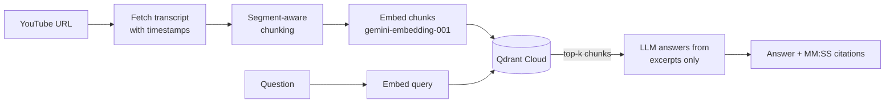

# YouTube Q&A (RAG)

Ask a YouTube video questions and get answers grounded in its transcript, with clickable timestamps that jump to the exact moment each answer came from.

**Live demo:** https://youtube-rag-qna.onrender.com


## How it works



1. **Transcript:** `youtube-transcript-api` pulls captions with per-segment start times and durations.
2. **Chunking:** consecutive segments are grouped to about 1000 characters with 200 characters of overlap. Chunks close on segment boundaries, so every chunk keeps an exact `start`/`end` timestamp.
3. **Embedding and storage:** chunks are embedded with `gemini-embedding-001` (3072 dimensions) and stored in Qdrant Cloud with the video ID, timestamps and text as payload.
4. **Retrieval:** the question is embedded, and the top 5 chunks for that video are retrieved by cosine similarity.
5. **Answering:** an LLM answers using only those excerpts, cites timestamps like `[02:15-03:20]`, and says so when the excerpts don't contain the answer. The UI turns each citation into a link to that moment in the video.

## Interfaces

| Interface | Entry point |
|---|---|
| Web UI + REST API (FastAPI) | `src/api.py`, static page in `src/static/` |
| Terminal UI (Textual) | `src/app.py` |
| Plain CLI | `src/main.py` |

API endpoints:

- `POST /videos` starts background indexing for a URL and returns immediately.
- `GET /videos/{video_id}/status` returns `indexing`, `ready` or `error`, which the frontend polls.
- `POST /videos/{video_id}/ask` takes a question (and optional `top_k`) and returns the answer plus source chunks with timestamps.
- `GET /health`

## Design decisions

- **Qdrant instead of ChromaDB.** Chroma needs a persistent disk, which free hosting tiers don't provide. Qdrant Cloud has a free tier. The migration meant deterministic UUID5 point IDs (so re-indexing overwrites instead of duplicating) and an explicit payload index on `video_id` for filtered search.
- **Segment-aware chunking instead of a generic text splitter.** A generic splitter loses the mapping from text back to caption timestamps, which the citations depend on.
- **Explicit embedding task types.** `RETRIEVAL_DOCUMENT` for chunks and `RETRIEVAL_QUERY` for questions are passed explicitly, because relying on library defaults gave wrong behavior.
- **Background indexing with status polling.** Indexing a long video takes a while, so the API returns at once and the UI polls. The job store is an in-memory dict, which is fine for a single instance; multiple workers would need Redis or a status field in Qdrant.
- **Hosting on Render.** The app depends on long-running processes and background tasks, which rules out serverless platforms. Pushes to `main` auto-redeploy.

## Evaluation

Retrieval quality was measured two ways on the same hand-labelled set: 18 questions, each with the time window of the video where the answer is spoken.

### 1. Manual, timestamp-based eval (`src/eval.py`)

A retrieved chunk counts as a hit if its time range overlaps the labelled window. This is deterministic, free and repeatable, so it was used to sweep chunk configurations.

| Chunk size / overlap | Chunks | Recall@1 | Recall@3 | Recall@5 | Precision@3 | Precision@5 |
|---|---|---|---|---|---|---|
| 500 / 100 | 29 | 0.78 | 0.89 | 0.94 | 0.69 | 0.80 |
| **1000 / 200** | 15 | **0.89** | **1.00** | **1.00** | 0.80 | 0.94 |
| 1500 / 300 | 10 | 0.78 | 0.94 | 1.00 | 0.87 | 0.97 |
| 2000 / 400 | 8 | 0.72 | 1.00 | 1.00 | 0.89 | 0.97 |

(Precision@1 equals Recall@1 by construction.)

**1000/200 is the default.** It is best at `k=1` (0.89 versus 0.72-0.78) and reaches full recall by `k=3`. Normalized precision rises with chunk size, so 1500/300 and 2000/400 score slightly higher at `k=3` and `k=5`, but two things make that difference less meaningful than it looks:

- This video produces only 10 and 8 chunks at those sizes, so the top 5 already covers half or more of the whole video. High recall and precision at `k=5` are close to guaranteed there.
- Bigger chunks put more text into each retrieved slot. Five 2000-character chunks give the LLM roughly twice the context of five 1000-character chunks, which neither metric penalizes.

At the other end, 500/100 is weakest, possibly because an answer gets split across several small chunks. That explanation is a hypothesis. The differences are also small: with 18 questions, 0.89 versus 0.78 at `k=1` is 16 versus 14 questions. Treat the sweep as evidence that the default is reasonable, not as proof that it is optimal.

Raw precision@k is not comparable across chunk sizes, because a short answer window touches only a few chunks and caps the achievable score. Precision is therefore normalized by `min(k, number of chunks overlapping the window)`.

### 2. LLM-judged eval with Ragas (`src/eval_ragas.py`)

The real pipeline answers all 18 questions, and Ragas scores the results against reference answers extracted from the transcript window (`src/eval_data.py`). The answer model was Gemma 4 26B and the judge was Gemma 4 31B.

Results for the default config (1000/200 chunks, top 5), all 18 questions scored:

| Metric | Score |
|---|---|
| Context recall | 1.000 |
| Context precision | 0.927 |
| Faithfulness | 0.965 |
| Answer relevancy | 0.796 |
| Timestamp precision@5 (manual) | 0.367 |
| Timestamp precision ceiling | 0.400 |

### What the comparison showed

- **The low raw timestamp precision is a ceiling effect.** Answer windows are short, so on average only about 2 of the 5 retrieved slots could possibly overlap one. Against that ceiling, retrieval reaches about 93% of the best achievable score, which agrees with Ragas's independent 0.93 context precision.
- **The weakest question was a ranking problem, not a retrieval miss.** For one question about how a probability changes with the assumed success rate, the two relevant chunks came back at ranks 3 and 4 behind two chunks from an earlier calculation that uses the same wording. Ragas scored it 0.417, which matches the hand calculation (1/3 + 2/4) / 2. Because all 5 chunks are passed to the LLM, the answer is unaffected, but the ordering would hurt at small `k`.
- **Next step this points to:** a reranker over a larger candidate set.

### Limitations of the eval

- 18 questions on a single video is a small sample.
- Context recall and the timestamp hit rate are both 1.0 at `k=5`, so they can't tell configurations apart; differences show up in precision and at small `k`.
- Answer relevancy uses a single generated question (`strictness=1`, because the Gemma API doesn't support multiple completions per request), so it is the noisiest metric.
- The generator and judge are both Gemma models.

## Known limitations

- YouTube blocks transcript requests from many cloud IP ranges, including common hosting providers, so fetching an arbitrary new video on the hosted demo can fail. Videos indexed ahead of time work. Locally, indexing any video with captions works.
- The job-status store is in memory, so it assumes one running instance.
- Only videos with captions (manual or auto-generated) can be indexed.

## Run it locally

Requires Python 3.14+ and [uv](https://docs.astral.sh/uv/).

```bash
git clone <your-repo-url>
cd youtube-rag-qna
uv sync
```

Create a `.env` file in the repo root:

```
GOOGLE_API_KEY=...
QDRANT_URL=...
QDRANT_API_KEY=...
```

Run from the repo root:

```bash
# Web UI + API (open http://localhost:8000)
uv run uvicorn api:app --app-dir src --reload

# Terminal UI
uv run python src/app.py

# Plain CLI
uv run python src/main.py
```

Evaluation scripts (they call the Gemini and Gemma APIs, so mind your free-tier quotas):

```bash
uv run python src/eval_data.py    # build reference answers from the transcript
uv run python src/eval.py         # chunk-config sweep (timestamp metrics)
uv run python src/eval_ragas.py   # Ragas run; re-running only scores what is missing
```

## Project layout

```
src/
  transcript.py   fetch + save transcripts
  chunker.py      segment-aware chunking with timestamps
  embedder.py     embeddings + Qdrant storage
  retriever.py    retrieval + grounded answer generation
  api.py          FastAPI app (background indexing, status, ask)
  app.py          Textual terminal UI
  main.py         plain CLI
  eval_data.py    labelled questions + reference answers
  eval.py         timestamp-based retrieval eval
  eval_ragas.py   Ragas evaluation
  static/         web frontend
```

## Tech stack

Python, FastAPI, Qdrant, LangChain (`langchain-google-genai`), Gemini embeddings, Gemma / Gemini chat models, `youtube-transcript-api`, Textual, Ragas, Render.
